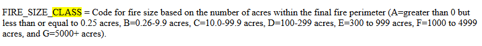
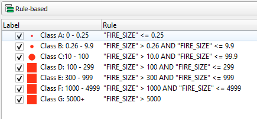
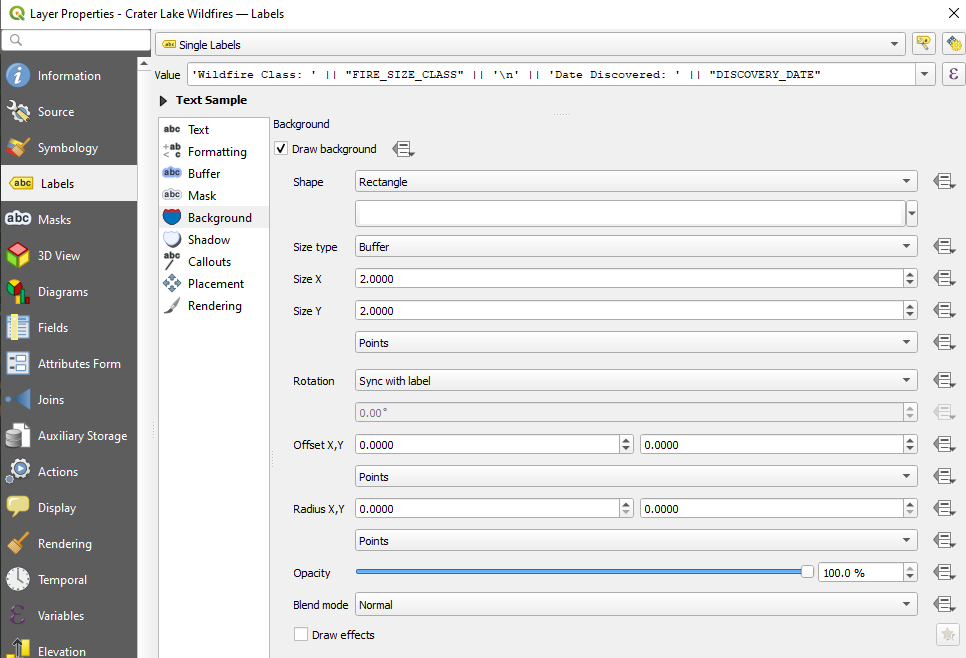
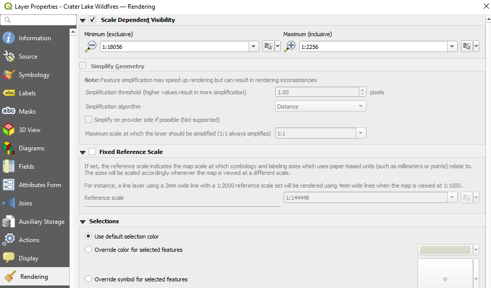

# Crater-Lake-Wildfires

This project was created to map all of the wildfires that occurred at Crater Lake, Oregon from 1992 to 2020 using the "Spatial wildfire occurrence data for the United States, 1992-2020" data set. Found at: *https://www.fs.usda.gov/rds/archive/catalog/RDS-2013-0009.6*

I visited Oregon on vacation in August of 2024 and one of the highlights of the trip was Crater Lake. My wife and I were there during a lot of wildfires, and many roads around the lake were closed off for safety. Being as close as we were to the wildfires (less than 2 miles) and hiking past several fire watch towers along trails, I got fairly interested in the culture of wildfires in the area.

 I used QuickOSM to create a perimeter around the edge of the lake, and then created a 5-mile radius line from that perimeter using the Buffer tool. I narrowed down the data set to what was inside of that 5-mile perimeter using the Intersect function. I went through the documentation of the wildfire data set and saw a further break down of the Fire_Size_Class attribute pertaining to acreage values.

 

 I used this breakdown to stylize the symbology of the different wildfires around Crater Lake

 

 I duplicated my narrowed-down data set and removed all symbols so they didn't appear on the map. I chose "Fire_Size_Class" and "Discovery_Date" as the two variables I wanted to be displayed as the user zooms in.

 

 I set the rendering for these labels to only appear between zoom levels 1:18056 (z15) and 1:2257 (z18).

